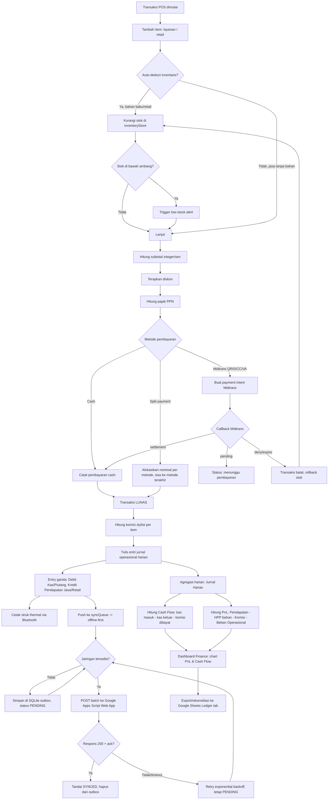

# Alur Sistem Keuangan — Salon POS Pro

Transaksi POS → jurnal → laporan. Semua nilai uang integer (sen/rupiah terkecil), tanpa float.

## Prinsip kunci

1. **Semua nominal uang** disimpan sebagai integer dalam satuan rupiah terkecil (tidak ada desimal rupiah → langsung integer rupiah, bukan float). Lihat `src/utils/money.ts`.
2. **Double-entry sederhana**: setiap transaksi POS menghasilkan minimal 2 baris jurnal (debit akun kas/piutang, kredit akun pendapatan), plus baris HPP dan komisi saat berlaku.
3. **Offline-first**: UI tidak pernah menunggu jaringan. Semua write masuk SQLite dulu → outbox table → background sync worker mendorong ke Apps Script.
4. **Idempotent sync**: setiap transaksi punya `localId` (UUID) yang dikirim ke Sheets sebagai primary key, sehingga retry tidak menduplikasi baris (Apps Script melakukan upsert berdasarkan `localId`).
5. **Rollback stok**: jika pembayaran Midtrans deny/expire, stok yang sudah di-deduct dikembalikan.
